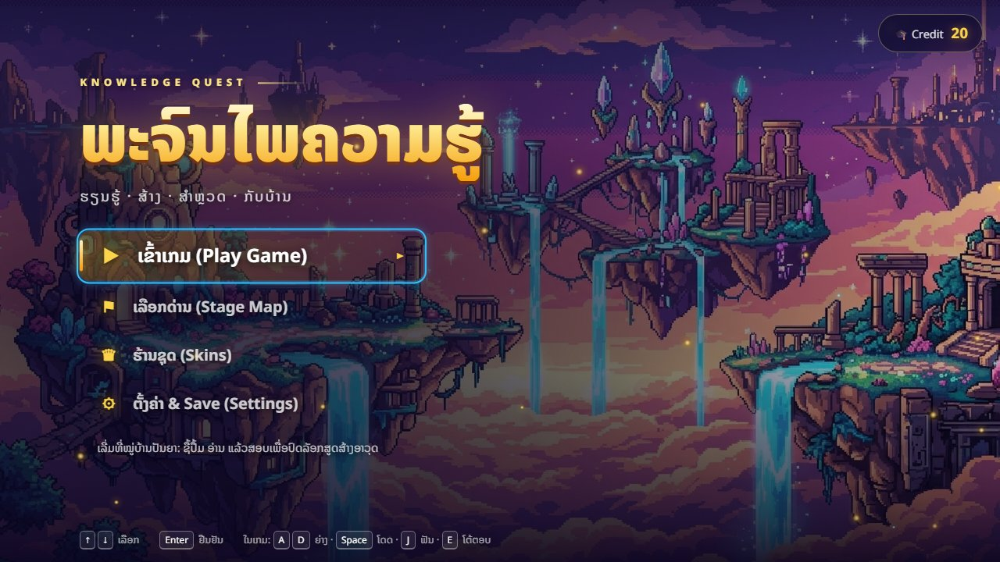

# ພະຈົນໄພຄວາມຮູ້ (Knowledge Quest)

ເກມຜະຈົນໄພ 2D ທີ່ໃຫ້ນັກຮຽນ **ຮຽນຈາກປຶ້ມຕຳລາ → ສອບ → ສ້າງເຄື່ອງມື/ອາວຸດ → ອອກສຳຫຼວດດ່ານ → ກັບມາໝູ່ບ້ານ** ແລ້ວວົນຄືນ. ສ້າງດ້ວຍ Phaser 4 + React + TypeScript + Vite.



> ເກມຍັງຢູ່ໃນຂັ້ນພັດທະນາ: ບົດທີ 1 ຫຼິ້ນໄດ້ຄົບ loop ໃນໂຄດ ແຕ່ຍັງບໍ່ໄດ້ playtest ກັບນັກຮຽນ. ເບິ່ງ [ສະຖານະ](#ສະຖານະ) ດ້ານລຸ່ມ.

## ເກມນີ້ເຮັດວຽກແນວໃດ

- **Credit** ໄດ້ຈາກການຮຽນເທົ່ານັ້ນ (ຜ່ານບົດສອບ, ຝຶກປະຈຳວັນ, ຊະນະ Boss ດ້ວຍການຕອບຄຳຖາມ). ການຂ້າສັດຕູບໍ່ໃຫ້ Credit.
- **ວັດສະດຸ** (ໄມ້, ຫີນ, ແຮ່ເຫຼັກ, ຜລຶກ…) ໄດ້ຈາກການສຳຫຼວດດ່ານເທົ່ານັ້ນ.
- ຊື້ປຶ້ມຕຳລາດ້ວຍ Credit → ອ່ານຄົບທຸກໜ້າ → ສອບຜ່ານ → ປົດລັອກສູດສ້າງ Pickaxe, ຄ້ອນ, Repair Kit ແລະດາບເຫຼັກ.
- ໃນດ່ານ: ຕັດໄມ້, ຂຸດແຮ່, ສູ້ກັບສັດຕູດ້ວຍດາບ, ສ້ອມປະຕູທີ່ພັງ (ຕ້ອງຕອບຄຳຖາມ), ແລ້ວສູ້ Boss ແລະຕອບຄຳຖາມປິດສາກ.
- ຕາຍ ຫຼືຖອຍ ເສຍວັດສະດຸ 50% (ຍົກເວັ້ນຜລຶກ ແລະ Boss Core). ກັບໝູ່ບ້ານຜ່ານຈຸດວາບທີ່ປອດໄພ ບໍ່ເສຍຫຍັງ.

ລາຍລະອຽດທັງໝົດ (ລາຄາ, HP, recipe, ກົດ) ຢູ່ [Game Design Doc](docs/Game%20Design%20Doc-Village%20Hub.md).

## ວິທີຫຼິ້ນ

| ປຸ່ມ | ໜ້າທີ່ |
| --- | --- |
| `A` `D` ຫຼື `←` `→` | ຍ່າງ |
| `W` / `Space` / `↑` | ໂດດ (ປ່ອຍໄວ = ໂດດຕ່ຳ). ໂດດຂຶ້ນ platform ໄດ້ |
| `J` ຫຼື `Z` | ຟັນດາບ (ການແຕະຕົວສັດຕູເສຍ 1 ຫົວໃຈ ຈຶ່ງຄວນຟັນຈາກໄລຍະໄກ) |
| `Q` | ສັບດາບທີ່ມີໃນກະເປົາ |
| `E` | ໂຕ້ຕອບ (ເຂົ້າອາຄານ, ເກັບວັດສະດຸ, ສ້ອມປະຕູ, ຈຸດວາບ) |
| `I` | ເປີດ/ປິດກະເປົາ (ໃຊ້ຢາ, ໃສ່ດາບ) |
| `Esc` / `P` | ປິດໜ້າຕ່າງທີ່ເປີດຢູ່ ຫຼືພັກເກມ |
| `M` / `B` | ເປີດ/ປິດສຽງເອັບເຟັກ / ສຽງເພງ |
| `F2` | ສະແດງ physics debug |

ຈຸດເລີ່ມຕົ້ນຂອງຜູ້ຫຼິ້ນໃໝ່: ເຂົ້າໝູ່ບ້ານ → ຫໍສະໝຸດ (ຊື້ປຶ້ມ 20 Credit) → ອ່ານ → ສະຖາບັນ (ສອບ) → ໂຮງຊ່າງ (ສ້າງເຄື່ອງມື) → ປະຕູມິຕິ (ເລືອກດ່ານ). ມີຜູ້ເຖົ້າໃນໝູ່ບ້ານໃຫ້ຄຳແນະນຳ. ເກມບັນທຶກອັດຕະໂນມັດ ແລະມີ 3 ຊ່ອງ Save ໃນ Settings (ເກັບໃນ `localStorage` ຂອງ browser).

## ເລີ່ມໃຊ້ງານ (ສຳລັບນັກພັດທະນາ)

ຕ້ອງມີ [Node.js](https://nodejs.org).

```bash
npm install
npm run dev-nolog      # ເຊີບເວີພັດທະນາ ທີ່ http://localhost:8080
```

| ຄຳສັ່ງ | ໜ້າທີ່ |
| --- | --- |
| `npm run dev-nolog` | ເຊີບເວີພັດທະນາ (ແນະນຳ; `npm run dev` ສົ່ງສະຖິຕິນິລະນາມຂອງ template, ເບິ່ງ [log.js](#ກ່ຽວກັບ-logjs)) |
| `npm run build-nolog` | build ສຳລັບ production ໄປທີ່ `dist/` |
| `npm run test` | unit test (Vitest): domain, application ແລະຕົວກວດ JSON |
| `npm run lint` | ESLint (ບັງຄັບກົດຊັ້ນຂອງໂຄດດ້ວຍ) |
| `npx tsc --noEmit -p tsconfig.json` | ກວດ type |
| `npm run test:e2e` | ທົດສອບ Playwright ດ້ວຍ browser ຈິງ (ເປີດເຊີບເວີເອງ). ແລ່ນແຍກຈາກ `build` ຖ້າບໍ່ດັ່ງນັ້ນອາດຊ້າຈົນຕົກ |

ບອທທົດລອງທີ່ຫຼິ້ນດ້ວຍຄີບອດຈິງ (ຕົວເລືອກ ໃຊ້ເວລາຫຼາຍນາທີ ແລະຍັງຫຼິ້ນບໍ່ຈົບ ເບິ່ງຫົວໄຟລ໌):

```bash
PLAYTHROUGH=1 npx playwright test e2e/playthrough.spec.ts
# PowerShell:  $env:PLAYTHROUGH=1; npx playwright test e2e/playthrough.spec.ts
```

## ໂຄງສ້າງໂປຣເຈັກ

ໃຊ້ Clean Architecture 3 ຊັ້ນ: ກົດເກມຢູ່ຊັ້ນໃນທີ່ບໍ່ຮູ້ຈັກ Phaser/React, UI ແລະ Phaser ຢູ່ຊັ້ນນອກ.

| ເສັ້ນທາງ | ມີຫຍັງ |
| --- | --- |
| `src/domain/` | entity ແລະກົດເກມ (Wallet, Backpack, Health, Book, Boss, GameState…). ບໍ່ import Phaser/React |
| `src/application/` | use case ໄຟລ໌ລະອັນ ພ້ອມ test (ຊື້ປຶ້ມ, ສອບ, craft, ຕີ, ເກັບ node, save/load…) |
| `src/infrastructure/phaser/` | scene ເກມ, ຕົວລະຄອນ/ສັດຕູ/Boss, controller ການສູ້ ແລະການໂຕ້ຕອບ, ຕົວສ້າງໝູ່ບ້ານ/ດ່ານ |
| `src/infrastructure/react/` | ໜ້າເມນູ, HUD, modal (ຫໍສະໝຸດ, ສະຖາບັນ, ໂຮງຊ່າງ, ກະເປົາ…) ແລະ hook |
| `src/infrastructure/content/` | ໂຫຼດ ແລະກວດ JSON ເນື້ອຫາຕອນເລີ່ມເກມ |
| `public/data/` | ເນື້ອຫາເກມ (JSON) |
| `public/assets/` | ພາບ, ພື້ນຫຼັງ, spritesheet ແລະໄຟລ໌ level |
| `e2e/` | ທົດສອບ Playwright |
| `docs/` | ເອກະສານ ການອອກແບບ, ADR ແລະແຜນງານ |

## ແກ້ເນື້ອຫາເກມ (ບໍ່ຕ້ອງແຕະໂຄດ)

ເນື້ອຫາຢູ່ໃນ `public/data/`. ເກມກວດຮູບແບບຕອນເລີ່ມ ແລະບອກ path ທີ່ຜິດ (ເຊັ່ນ `items.json: items[3].maxStack must be a number`).

| ໄຟລ໌ | ແກ້ຫຍັງ |
| --- | --- |
| `books.json` | ປຶ້ມ, ລາຄາ, ໜ້າເນື້ອຫາ, ສູດທີ່ປົດລັອກ |
| `questions.json` | ຄຳຖາມ (ໃຊ້ໃນບົດສອບ, ປະຕູ, Boss ແລະຝຶກປະຈຳວັນ), ຄຳຕອບ, ຄຳອະທິບາຍ, ໜ້າອ້າງອີງ |
| `items.json` | ໄອເທັມ, ຂະໜາດ stack, ຊະນິດ, `story` (ບໍ່ເສຍຕອນຕາຍ) |
| `recipes.json` | ສູດ craft ແລະອັບເກຣດດາບ |
| `enemies.json` | HP ແລະຂອງຕົກຂອງສັດຕູ/Boss |
| `stages.json` | ເຂດ, node ວັດສະດຸ, ຈຸດເກີດສັດຕູ, ປະຕູ, Boss, ຈຸດວາບ |
| `assets/levels/*.json` | ຕຳແໜ່ງ platform, ໜາມ ແລະຈຸດເກີດຜູ້ຫຼິ້ນ |

ແກ້ແລ້ວແລ່ນ `npm run test` ເພື່ອກວດວ່າ id ທີ່ອ້າງຫາກັນຍັງຖືກ (ສູດ → ໄອເທັມ, ຄຳຖາມ → ໜ້າປຶ້ມ, ສັດຕູໃນດ່ານ → `enemies.json`) ແລະ platform ທຸກອັນຍັງໂດດຂຶ້ນໄດ້.

## ເອກະສານ

- [Game Design Doc](docs/Game%20Design%20Doc-Village%20Hub.md): ການອອກແບບເກມ ລາຄາ ກົດ ແລະສະຖານະ (ພາສາລາວ).
- [CONTEXT.md](CONTEXT.md): ຄຳສັບຂອງເກມ (Chapter, Stage, Credit, Material…) ແລະຄຳທີ່ບໍ່ຄວນໃຊ້.
- [CLAUDE.md](CLAUDE.md): ວິທີໂຄດເຮັດວຽກ, ກົດ ແລະຄຳສັ່ງ.
- [docs/adr/](docs/adr/): ເຫດຜົນຂອງການຕັດສິນໃຈດ້ານສະຖາປັດຕະຍະກຳ.
- [docs/plans/](docs/plans/HISTORY.md): ແຜນ ແລະບັນທຶກສິ່ງທີ່ເຮັດໄປແລ້ວ.

## ສະຖານະ

ເຮັດແລ້ວ: ໝູ່ບ້ານ (ຫໍສະໝຸດ, ສະຖາບັນ, ໂຮງຊ່າງ, ໂຮງຕີເຫຼັກ), ບົດທີ 1 ທັງ 4 ເຂດ, Mini-boss ແລະ Boss 3 phase, ລະບົບປຶ້ມ/ສອບ/ຝຶກປະຈຳວັນ, craft, ຊື້ Skin ດ້ວຍ Credit, Save 3 ຊ່ອງ.

ຍັງຄ້າງ:
- playtest ກັບນັກຮຽນ ແລະປັບ balance (ຕົວເລກປັດຈຸບັນເປັນຄ່າຊົ່ວຄາວ, ໂດຍສະເພາະ HP ສັດຕູ ແລະລາຄາ Skin).
- ຄຳຖາມບົດທີ 2 ຍັງມີ 5 ຂໍ້ (ຄວນ ≥ 15 ກ່ອນເປີດໃຫ້ນັກຮຽນ).
- ສຽງ/sprite/animation ແທນຮູບຮ່າງງ່າຍໆທີ່ແຕ້ມດ້ວຍໂຄດ.
- Cave Guardian ຍັງບໍ່ມີ 2 ທ່າໂຈມຕີ.

## ກ່ຽວກັບ log.js

ໂປຣເຈັກເລີ່ມຈາກ [template ຂອງ Phaser](https://github.com/phaserjs/template-react-ts) ທີ່ມີ `log.js` ສົ່ງຂໍ້ມູນນິລະນາມ 3 ຢ່າງ (ຊື່ template, dev/prod, ເວີຊັນ Phaser) ໄປທີ່ `gryzor.co` ເມື່ອໃຊ້ `npm run dev` ຫຼື `npm run build`. ບໍ່ມີຂໍ້ມູນສ່ວນຕົວ. ຖ້າບໍ່ຢາກສົ່ງ ໃຫ້ໃຊ້ `npm run dev-nolog` / `npm run build-nolog` ຫຼືລຶບ `log.js` ແລະການເອີ້ນໃນ `package.json`.

## License

MIT. ໂຄດເລີ່ມຕົ້ນມາຈາກ template ຂອງ Phaser Studio Inc; ເບິ່ງ [LICENSE](LICENSE).
